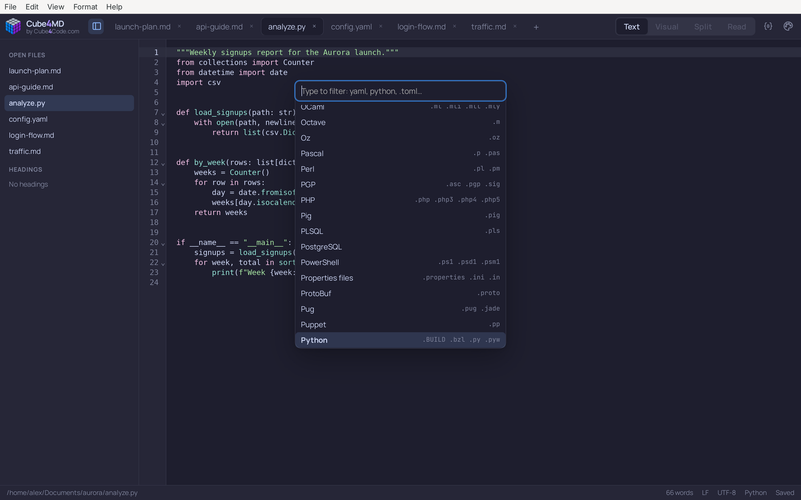
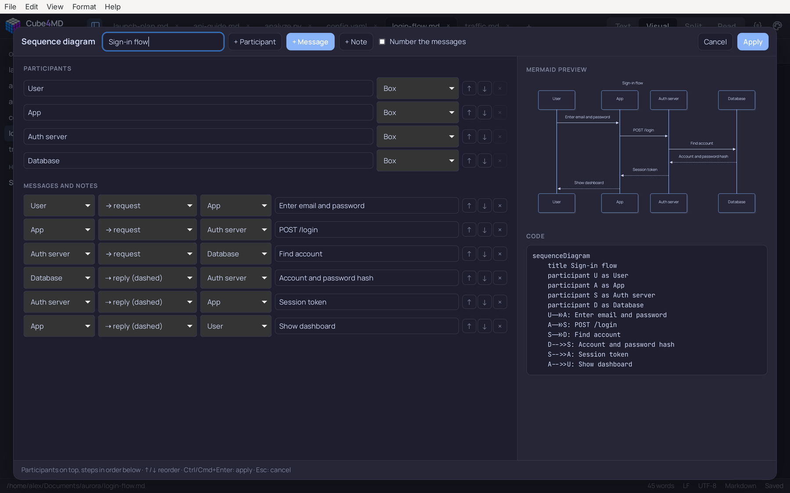
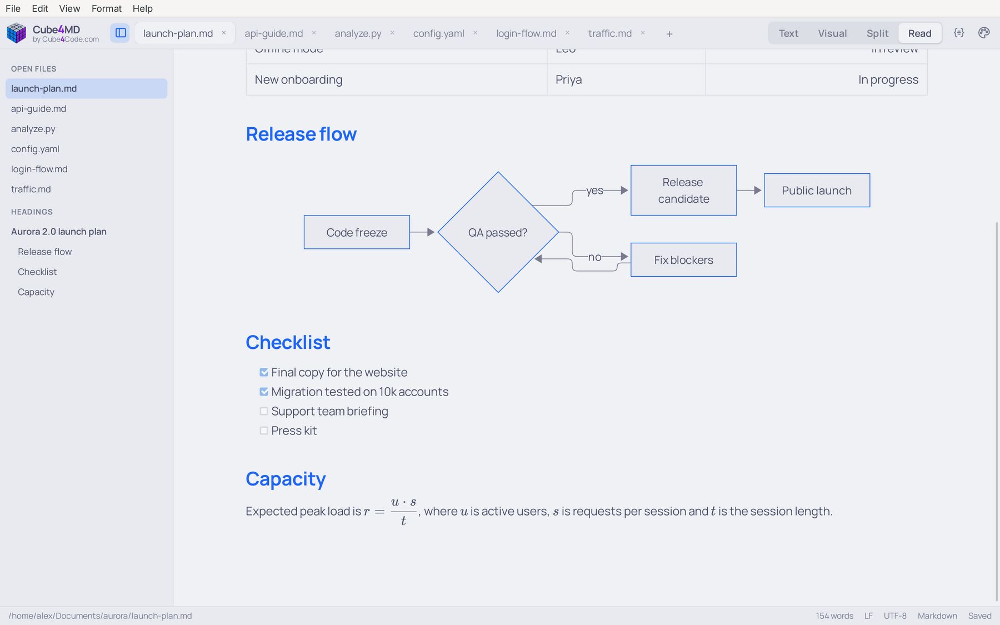

 <b>Cube4MD</b> · by <a href="https://cube4code.com">Cube4Code.com</a>

# Cube4MD

**A free tabbed Markdown editor that changes only what you edit and keeps your files on your computer.**

[Versão em português](#cube4md-português)

## Download

Download the latest version from the [Releases page](../../releases/latest).

| System | File |
|---|---|
| Windows 10 and 11 | `Cube4MD_…_x64-setup.exe` (installer), or `Cube4MD_…_x64_en-US.msi` / `_pt-BR.msi` (MSI installer in English or Portuguese). `Cube4MD-portable.exe` runs without installing. |
| macOS 11 or later, Apple silicon (M1 or newer) | `Cube4MD_…_aarch64.dmg` |
| Linux (Debian, Ubuntu and derivatives) | `Cube4MD_…_amd64.deb` |

The interface is in English or Portuguese and follows your system language.

### Opening it for the first time

Preview versions are not signed with a paid certificate yet, so your system asks you to confirm once:

- **Windows:** if SmartScreen shows a warning, click **More info**, then **Run anyway**.
- **macOS:** open the `.dmg` and drag Cube4MD to Applications. When you first open it, macOS says it could not verify the app and offers only **Done** or **Move to Trash**. Click **Done**, open **System Settings > Privacy & Security**, scroll down to Security, click **Open Anyway** next to Cube4MD and confirm. After that it opens normally.

## Features

**Tabs, not vaults.** Open any `.md` file from anywhere, like in Notepad++. No vault, no account, no library to import into. Your tabs come back when you reopen the app, including unsaved and untitled ones. Right-click a tab to close tabs in groups, rename the file, show it in its folder or copy its path.

**Four ways to work.** Text (the Markdown source), Visual (edit the formatted page directly), Split (source and preview side by side) and Read.

**Saves only what you changed.** Edit one paragraph in Visual mode and only that paragraph changes on disk. List markers, heading style, blank lines, line endings and encoding everywhere else stay byte for byte as they were.

**Code and data files too.** Open YAML, JSON, Python, SQL, XML and many other files: more than 130 languages, each with its own syntax colors. Pick the language from the status bar, as in Notepad++. The Format button tidies JSON (Python dicts and JSON5 too), YAML, XML and SQL (any database's syntax), in a whole file or in a code block inside a document. HTML files also open in Split and Read, drawn as a page next to the code; their scripts never run and nothing is loaded from the internet.

**Diagrams you can draw.** Mermaid diagrams render as you type. Flowcharts, sequence diagrams, Gantt charts and pie charts also have visual editors: add steps, participants or slices in a form and Cube4MD writes the Mermaid code for you.

**Everything else you expect:**

- Math with KaTeX, tables, task lists, GitHub alerts (note, tip, important, warning, caution) and front matter shown as a properties card.
- Find and replace in a floating window, across all open tabs or in a whole folder. Mark all, bookmarks, line tools, go to line, compare two tabs and optional Vim keys.
- Numbered headings, focus mode (F11) and presentation mode (F5), which turns a document into slides at each `---`.
- Encodings: UTF-8, UTF-16 and Windows-1252, detected when a file opens and kept when it is saved.
- Images you paste or drop are saved in an `assets` folder next to the document.
- Export to HTML and print or save as PDF with the same look you see on screen, or copy as rich text.
- 56 themes: Light, Dark, Sepia and 53 terminal themes from Cube4Themes.

## Privacy

Your documents never leave your computer. There is no account, no cloud, no telemetry, no usage statistics and no automatic updates.

The app is built so that it cannot send anything. Its window refuses every internet connection and any navigation outside the app, the native part has no network code, and exported HTML loads nothing from the internet. Web links open in your browser, and only when you click them.

**Images.** For the same reason, Cube4MD shows local images only from the document's folder and its subfolders (`assets/photo.png`, `images/chart.png`), and never loads images from the internet. An image anywhere else (`../images/chart.png`, `C:\Photos\chart.png`) or online is replaced by a short note explaining why. To use it, drag or paste the image into the document: Cube4MD copies it to the `assets` folder next to the document and links it there.

Why the limit: the window shows documents like a web page and reads local images through an internal channel. Keeping that channel inside the document's folder means that even a malicious document that found a flaw could not see any other file on your computer.

## License

Cube4MD is **freeware**: free to download and use, at home or at work, but it is not open source. Only Cube4Code builds and distributes it. See the [Cube4MD Freeware License](LICENSE). It includes open source components that keep their own licenses; the full list is in **Help > Third-Party Licenses**.

---

# Cube4MD (português)

**Um editor de Markdown gratuito, com abas, que muda só o que você edita e mantém seus arquivos no seu computador.**

## Download

Baixe a versão mais recente na [página de Releases](../../releases/latest).

| Sistema | Arquivo |
|---|---|
| Windows 10 e 11 | `Cube4MD_…_x64-setup.exe` (instalador), ou `Cube4MD_…_x64_en-US.msi` / `_pt-BR.msi` (instalador MSI em inglês ou português). `Cube4MD-portable.exe` roda sem instalar. |
| macOS 11 ou mais novo, chip Apple (M1 em diante) | `Cube4MD_…_aarch64.dmg` |
| Linux (Debian, Ubuntu e derivados) | `Cube4MD_…_amd64.deb` |

A interface é em inglês ou português e segue o idioma do sistema.

### Abrindo pela primeira vez

As versões de prévia ainda não são assinadas com certificado pago, então o sistema pede uma confirmação uma única vez:

- **Windows:** se o SmartScreen mostrar um aviso, clique em **Mais informações** e depois em **Executar assim mesmo**.
- **macOS:** abra o `.dmg` e arraste o Cube4MD para Aplicativos. Na primeira vez que abrir, o macOS diz que não conseguiu verificar o app e mostra só **OK** ou **Mover para o Lixo**. Clique em **OK**, abra **Ajustes do Sistema > Privacidade e Segurança**, role até Segurança, clique em **Abrir Mesmo Assim** ao lado do Cube4MD e confirme. Depois disso ele abre normalmente.

## Recursos

**Abas, sem cofre.** Abra qualquer arquivo `.md` de qualquer pasta, como no Notepad++. Sem cofre, sem conta, sem biblioteca para importar. As abas voltam quando você reabre o app, incluindo as não salvas e as sem título. Clique com o botão direito numa aba para fechar abas em grupo, renomear o arquivo, mostrá-lo na pasta ou copiar o caminho.

**Quatro jeitos de trabalhar.** Texto (o código Markdown), Visual (edita a página formatada direto), Dividido (código e prévia lado a lado) e Leitura.

**Salva só o que você mudou.** Edite um parágrafo no modo Visual e só esse parágrafo muda no disco. Marcadores de lista, estilo dos títulos, linhas em branco, quebras de linha e codificação no resto do arquivo ficam idênticos, byte a byte.

**Arquivos de código e dados também.** Abra YAML, JSON, Python, SQL, XML e muitos outros arquivos: mais de 130 linguagens, cada uma com suas cores. Escolha a linguagem na barra de status, como no Notepad++. O botão Formatar organiza JSON (também dicionários do Python e JSON5), YAML, XML e SQL (de qualquer banco de dados), no arquivo inteiro ou num bloco de código dentro de um documento. Arquivos HTML também abrem no Dividido e no Leitura, desenhados como página ao lado do código; os scripts nunca rodam e nada é carregado da internet.

**Diagramas que você desenha.** Os diagramas Mermaid aparecem enquanto você digita. Fluxogramas, diagramas de sequência, Gantt e pizza também têm editores visuais: você adiciona etapas, participantes ou fatias num formulário e o Cube4MD escreve o código Mermaid.

**E tudo o que você espera:**

- Fórmulas com KaTeX, tabelas, listas de tarefas, alertas do GitHub (nota, dica, importante, aviso, cuidado) e propriedades (front matter) num cartão.
- Localizar e substituir em janela solta, em todas as abas abertas ou numa pasta inteira. Marcar tudo, marcadores, ferramentas de linha, ir para linha, comparar duas abas e teclas do Vim opcionais.
- Títulos numerados, modo foco (F11) e modo apresentação (F5), que transforma o documento em slides a cada `---`.
- Codificações: UTF-8, UTF-16 e Windows-1252, detectadas ao abrir e mantidas ao salvar.
- Imagens coladas ou arrastadas são salvas numa pasta `assets` ao lado do documento.
- Exportar para HTML e imprimir ou salvar como PDF com a mesma aparência da tela, ou copiar como texto formatado.
- 56 temas: Claro, Escuro, Sépia e 53 temas de terminal do Cube4Themes.

## Privacidade

Seus documentos nunca saem do seu computador. Não há conta, nuvem, telemetria, estatísticas de uso nem atualização automática.

O app é feito para não conseguir enviar nada. A janela recusa qualquer conexão com a internet e qualquer navegação para fora do app, a parte nativa não tem código de rede e o HTML exportado não carrega nada da internet. Links da web abrem no seu navegador, e só quando você clica.

**Imagens.** Pelo mesmo motivo, o Cube4MD só mostra imagens locais da pasta do documento e das subpastas dela (`assets/foto.png`, `imagens/grafico.png`) e nunca carrega imagens da internet. Uma imagem em outro lugar (`../imagens/grafico.png`, `C:\Fotos\grafico.png`) ou na internet aparece como um aviso curto explicando o motivo. Para usá-la, arraste ou cole a imagem no documento: o Cube4MD copia para a pasta `assets` ao lado dele e cria o link.

Por que a trava: a janela mostra o documento como uma página web e lê as imagens locais por um canal interno. Manter esse canal dentro da pasta do documento faz com que, mesmo que um documento malicioso achasse uma falha, ele não conseguisse ver nenhum outro arquivo do seu computador.

## Licença

O Cube4MD é **freeware**: gratuito para baixar e usar, em casa ou no trabalho, mas não é open source. Só a Cube4Code compila e distribui o programa. Veja a [licença freeware do Cube4MD](LICENSE) (em inglês). Ele inclui componentes open source que mantêm as próprias licenças; a lista completa está em **Ajuda > Licenças de terceiros**.
