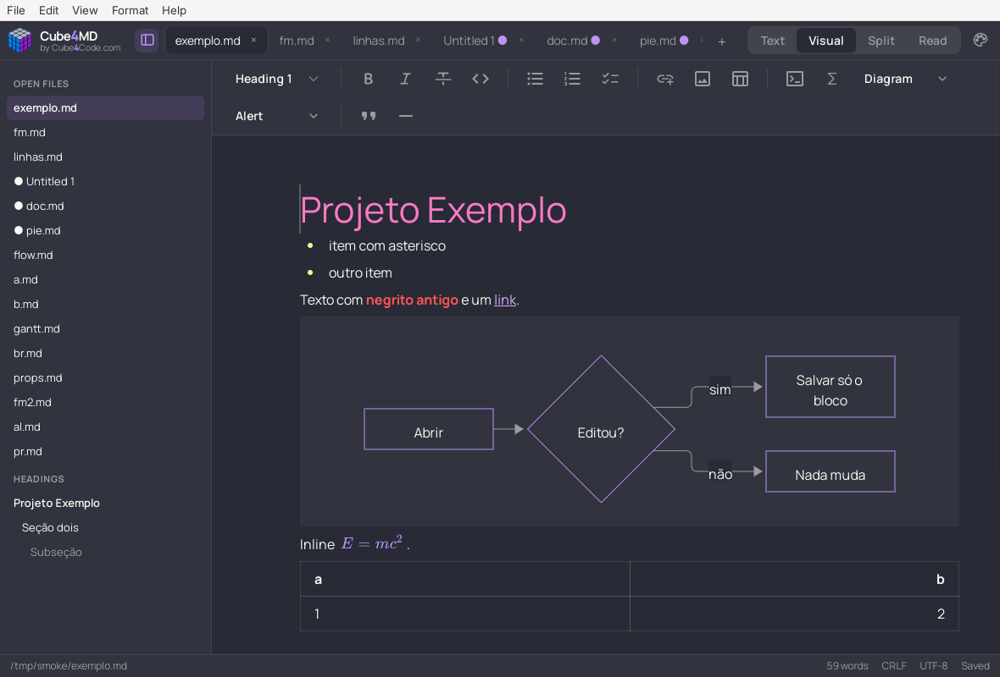
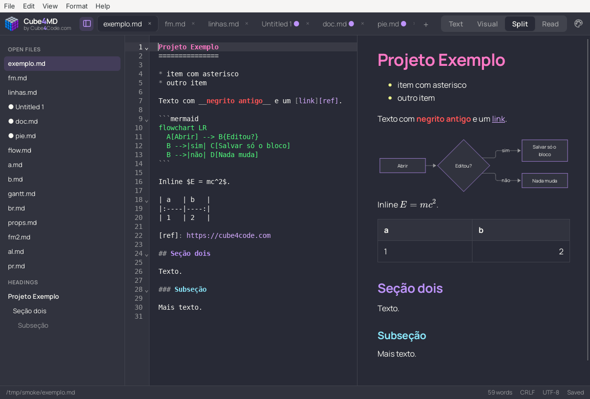
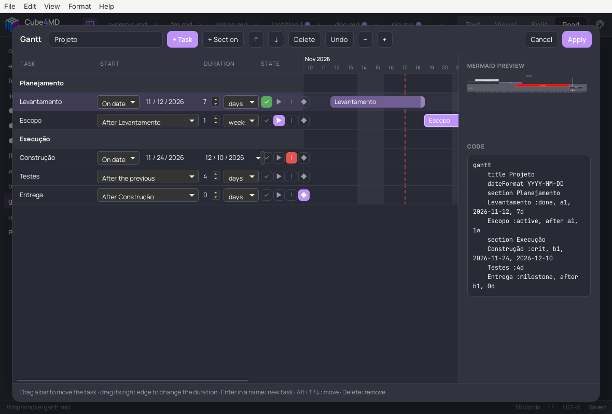

 <b>Cube4MD</b> · by <a href="https://cube4code.com">Cube4Code.com</a>

# Cube4MD

**A free Markdown editor that edits your `.md` files and leaves everything else exactly as it was.**
Versão em português abaixo.

## Download

Get the latest version on the [Releases page](../../releases/latest).

| System | File |
|---|---|
| Windows 10 and 11 | `Cube4MD_…_x64-setup.exe` (installer) or `Cube4MD_…_x64_en-US.msi` / `_pt-BR.msi`; `Cube4MD-portable.exe` runs without installing |
| macOS 11 or newer | `Cube4MD_…_universal.dmg` (coming soon) |
| Linux (Debian, Ubuntu) | `Cube4MD_…_amd64.deb` |

Preview versions are not signed yet: Windows SmartScreen may ask you to confirm ("More info" > "Run anyway").

## What it does

- Notepad++ style tabs for `.md` files, no vault, no account. Restored on restart, unsaved and untitled tabs included.
- Four modes: Text, Visual (WYSIWYG), Split and Reading.
- Saves only what you changed: list markers, headings, blank lines, line endings and encoding elsewhere stay byte for byte.
- Find and replace in a floating window, also in all tabs and in a folder; mark all, bookmarks, line tools, go to line, compare two tabs, optional Vim keys.
- Mermaid diagrams with drawing editors for flowcharts and Gantt charts, KaTeX math, tables, GitHub alerts, front matter as a properties card.
- Pasted or dropped images saved in an `assets` folder next to the document.
- Export to HTML, print and save as PDF, copy as rich text. 56 themes (Cube4Themes).

## Privacy

Your documents never leave your computer. No account, no cloud, no telemetry, no analytics, no automatic updates. The app is locked so it cannot send anything: its window refuses every internet connection and navigation outside the app, the native side has no network code, and exported HTML loads nothing from the internet. Web links open in your browser only when you click them.

## License

Cube4MD is **freeware**: free to download and use, at home or at work, but not open source. Only Cube4Code builds and distributes it. See the [Cube4MD Freeware License](LICENSE). It includes open source components that keep their own licenses.

---

# Cube4MD (português)

**Um editor de Markdown gratuito que edita seus arquivos `.md` e deixa todo o resto exatamente como estava.**

## Download

Baixe a versão mais recente na [página de Releases](../../releases/latest).

| Sistema | Arquivo |
|---|---|
| Windows 10 e 11 | `Cube4MD_…_x64-setup.exe` (instalador) ou `Cube4MD_…_x64_en-US.msi` / `_pt-BR.msi`; `Cube4MD-portable.exe` roda sem instalar |
| macOS 11 ou mais novo | `Cube4MD_…_universal.dmg` (em breve) |
| Linux (Debian, Ubuntu) | `Cube4MD_…_amd64.deb` |

As versões de prévia ainda não são assinadas: o SmartScreen do Windows pode pedir confirmação ("Mais informações" > "Executar assim mesmo").

## O que ele faz

- Abas no estilo do Notepad++ para arquivos `.md`, sem cofre e sem conta. A sessão volta ao reabrir, incluindo abas não salvas e sem título.
- Quatro modos: Texto, Visual, Dividido e Leitura.
- Salva só o que você mudou: marcadores de lista, títulos, linhas em branco, quebras de linha e codificação no resto do arquivo ficam idênticos.
- Localizar e substituir em janela solta, também em todas as abas e numa pasta; marcar tudo, marcadores, ferramentas de linha, ir para linha, comparar abas, teclas do Vim opcionais.
- Diagramas Mermaid com editores de desenho para fluxograma e Gantt, fórmulas KaTeX, tabelas, alertas do GitHub, propriedades (front matter) num cartão.
- Imagens coladas ou arrastadas salvas numa pasta `assets` ao lado do documento.
- Exportar para HTML, imprimir e salvar como PDF, copiar como texto formatado. 56 temas (Cube4Themes).

## Privacidade

Seus documentos nunca saem do seu computador. Sem conta, sem nuvem, sem telemetria, sem estatísticas de uso, sem atualização automática. O app é travado para não conseguir enviar nada: a janela recusa qualquer conexão com a internet e qualquer navegação para fora do app, o lado nativo não tem código de rede e o HTML exportado não carrega nada da internet. Links da web abrem no seu navegador só quando você clica.

## Licença

O Cube4MD é **freeware**: gratuito para baixar e usar, em casa ou no trabalho, mas não é open source. Só a Cube4Code compila e distribui o programa. Veja a [licença freeware do Cube4MD](LICENSE) (em inglês). Ele inclui componentes open source que mantêm as próprias licenças.
